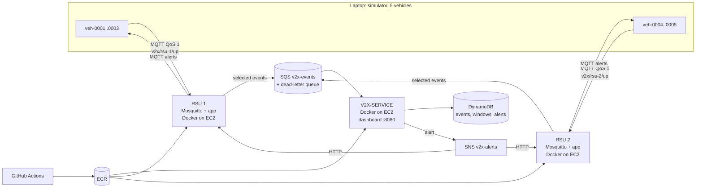
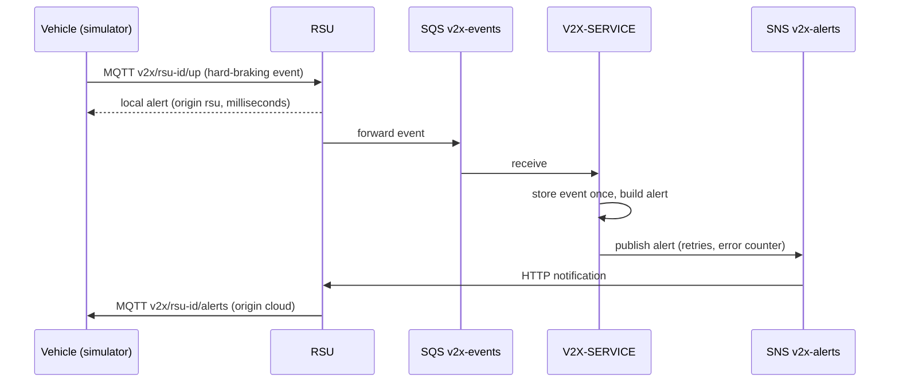

# V2X Distributed Monitoring

Simulated vehicles send safety messages to roadside units (RSUs) over MQTT. The RSUs process them at the edge,
raise time-critical local alerts and forward selected events to the cloud through SQS. A service on EC2 stores them
and raises cloud-level alerts, which SNS distributes back to the RSUs and from there to the vehicles.

## Architecture



Three paths, with different tolerance for delay:

- **Event path:** vehicle → RSU (MQTT) → SQS → V2X-SERVICE → DynamoDB. Durable and decoupled; the service consumes at its own pace.
- **Alert path:** V2X-SERVICE → SNS → RSUs (HTTP) → vehicles (MQTT). Separate from the event path so an urgent alert is never queued behind routine telemetry. The RSU also raises its own alert locally, without waiting for the cloud.
- **DevOps path:** GitHub Actions tests, builds and pushes images to ECR; EC2 instances pull the tagged image and run it (`deploy.sh`, through SSM).



## Components and status

| Component | Where | Status |
|---|---|---|
| Vehicle simulator (MQTT and SQS transports, fault injection) | `simulator/` | done, tested |
| V2X-SERVICE (consumer, idempotent storage, alerts to SNS, dashboard) | `services/v2x-service/` | done, tested, deployed |
| AWS infrastructure, one command | `infra/aws/bootstrap.sh` | done, run on Learner Lab |
| Experiment tooling and results | `infra/scripts/`, `docs/RESULTS.md` | done for the cloud path |
| RSU (MQTT broker, edge processing, local alert, buffering, SNS to MQTT) | `services/rsu/` | **partner: see RSU section of `docs/DESIGN.md`** |
| CI/CD for both images | `.github/workflows/` | service done; RSU image in progress |

## Design

See [`docs/DESIGN.md`](docs/DESIGN.md): event and alert schemas, SQS and SNS configuration with justification,
retry and acknowledgement behaviour, idempotency, the RSU edge processing and buffering policy, known limitations.
Measured results: [`docs/RESULTS.md`](docs/RESULTS.md). How to repeat them: [`docs/EXPERIMENTS.md`](docs/EXPERIMENTS.md).

## Structure

```text
.github/workflows/    ci.yml, aws-check.yml, ecr-smoke.yml
simulator/            simulator, scenarios, transports (see simulator/README.md)
services/v2x-service/ app.py, alerts.py, dashboard.html, Dockerfile
services/rsu/         RSU application and Dockerfile
schema/               event and alert JSON Schemas
infra/aws/            bootstrap.sh (creates all AWS resources), EC2 user data scripts
infra/scripts/        experiments.py, metrics.py, queue_depth.py, run_metrics.sh
dev/                  mosquitto.conf for a local broker
docs/                 DESIGN.md, RESULTS.md, EXPERIMENTS.md
tests/unit/           unit tests
results/              CSV output of the experiments
```

## Run it

Requirements: an AWS Academy Learner Lab session (`us-east-1`) with credentials in `~/.aws/credentials`,
AWS CLI v2, Docker, Python 3.12+.

```bash
# 1. all AWS resources: SQS + DLQ, 3 DynamoDB tables, SNS topic, 2 ECR repositories,
#    security groups and 3 EC2 instances (v2x-service, rsu-1, rsu-2). Safe to run repeatedly.
bash infra/aws/bootstrap.sh

# 2. images and deployment: push to main; CI builds, pushes to ECR and deploys through SSM.
#    Manual deployment of a tag:
aws ssm send-command --document-name AWS-RunShellScript --targets Key=tag:Role,Values=v2x-service \
  --parameters 'commands=["/opt/v2x/deploy.sh <tag>"]'

# 3. vehicles: through the RSUs over MQTT (or --transport sqs straight to the queue)
python -m simulator --transport mqtt --rsu1 <rsu-1 ip> --rsu2 <rsu-2 ip>
```

Dashboard: `http://<v2x-service ip>:8080`. The addresses are printed at the end of `bootstrap.sh`.
Local test without AWS: `docker run --rm -p 1883:1883 -v "$PWD/dev/mosquitto.conf:/mosquitto/config/mosquitto.conf" eclipse-mosquitto`
and `python -m simulator --transport mqtt --time-scale 10`.

## Tests

```bash
pip install pytest jsonschema -r simulator/requirements.txt
python -m pytest -q
```

## CI/CD configuration

Repository secrets `AWS_ACCESS_KEY_ID`, `AWS_SECRET_ACCESS_KEY`, `AWS_SESSION_TOKEN` (Learner Lab credentials,
they expire with every session) and variables `AWS_REGION = us-east-1`, `ECR_REPOSITORY = v2x-service`.
Delivery strategy: **ECR**, images tagged with the commit SHA.
